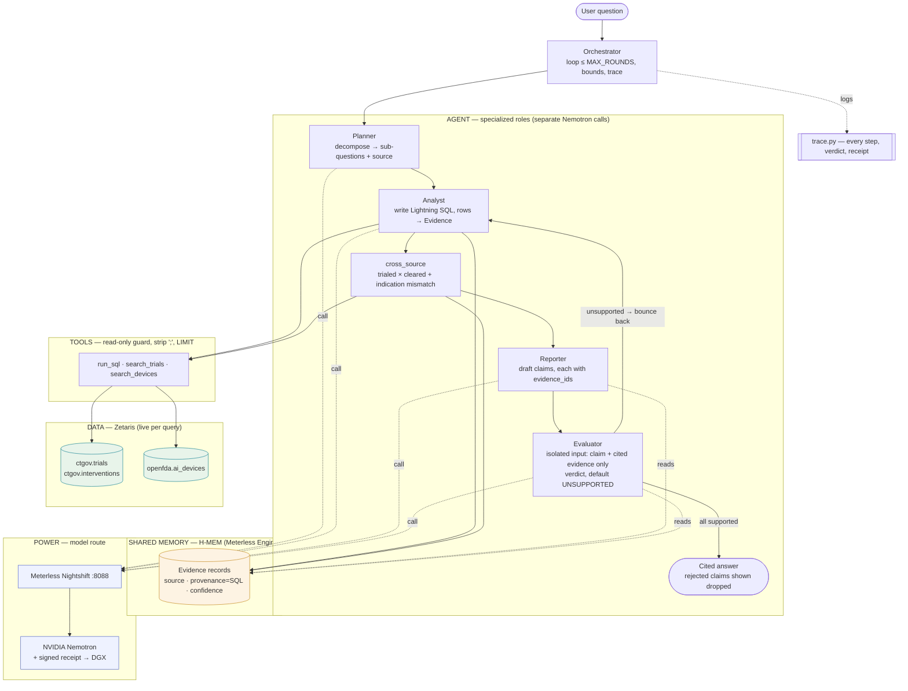

# Agent architecture

## Reading it
- **One request** flows Planner → Analyst → cross_source → Reporter → Evaluator, looping up to `MAX_ROUNDS`.
- **Feedback loop (the differentiator):** Evaluator bounces any unsupported claim back to the Analyst; only evidence-backed claims survive.
- **Every data fetch** is live Lightning SQL over Zetaris (`ctgov.*`, `openfda.*`) through read-only tools.
- **Evidence** lives in H-MEM (the required Meterless Engine) with mandatory `source`/`provenance`/`confidence`.
- **Every model call** routes through Meterless → Nemotron, returning a signed receipt (Sponsor-tech + DGX).
- **trace.py** records every step, verdict, and receipt (Technical + the demo's "show how it reasoned").
